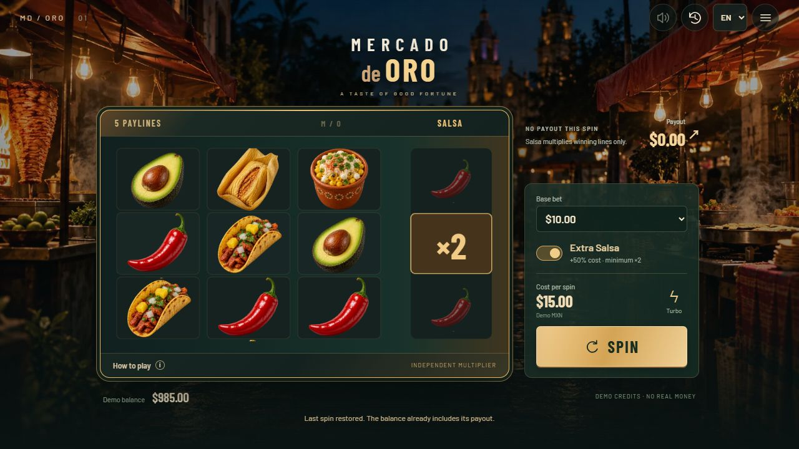

# Mercado de Oro

街头食物游戏的第一个可玩版本。开发分支 `codex/street-food-slot`，从已提交的点球版本 `2ac8013` 分出。点球入口、规则和素材继续保留在仓库根目录；新游戏的独立入口在本目录。

## 已实现

- **实际 PixiJS 8 转轴**：3×3 主盘、五条固定线、第四列独立倍率；GSAP 编排三列停轴、倍率揭示和中奖线。
- 八种原创写实食物、夜市背景、黄金塔可 Wild、常规与 Extra Salsa 两种模式、八档基础下注。
- Extra 支付基础下注的 150%，移除 ×1；五线仍按基础下注平分计算。未中奖时高倍率仍为零。
- `es-MX` 默认语言和 `en-US` 切换；首次加载后的玩法弹窗、可展开赔付表、金额与净收益明细。
- 快速模式、动画快速揭示、音效开关、历史收据及只读重播。仅净收益为正时播放胜利音效；部分返还明确标记为返还。
- 幂等的本地开奖与原子账本、整数金额、刷新后重演已接受结果、存储失败提示、无效存档恢复、演示重置。
- 手机布局、键盘与可访问 HTML 控件、后台暂停、WebGL 丢失时锁定新旋转并保留结果。
- 单文件网络预览导出；图片和字体内嵌，避免 HTMLPreview 的相对路径和资源跨域问题。

## 本地运行

从仓库根目录执行：

```sh
npm ci
npm run dev:mercado       # http://127.0.0.1:5180/
npm run test:mercado
npm run verify:mercado
npm run build:mercado
npm run verify:mercado-assets
npm run preview:mercado   # http://127.0.0.1:4180/
```

Node.js 22.18+，或当前安装的 Node.js 24。构建输出 `dist-mercado/`，仓库预览文件为 [standalone.html](standalone.html)。点球的 `npm run dev`、`npm test`、`npm run build` 仍是原入口。

## 明确的数学配置

这是本游戏独立设计的概率配置，不宣称复制 Fortune Gems 未公开的概率表。

设基础投注为 B，实际支付为 C，普通 C=B，Extra C=1.5B。每条中奖线的单线赔率为 p，最终赔付是 `B × Σp ÷ 5 × M`；倍率只应用一次。不另设整盘奖励或截断赔付。

每个主轴有 64 个等概率停点，停点表示中间符号。三个主轴独立抽取；倍率使用另一命名随机流。冻结的轴条与倍率整数权重见 [config.ts](src/core/config.ts)，完整哈希和精确报告见 [math-certificate.json](docs/math-certificate.json)。

| 指标 | 普通 | Extra |
| --- | ---: | ---: |
| 按实际支付计算的理论 RTP | 96.5% | 96.5% |
| 倍率均值 | 1.8007010071 | 2.7010515106 |
| 单局净盈利概率 | 19.7820% | 24.7016% |
| 返还大于零且小于支付概率 | 37.8608% | 33.7693% |
| 每次实际支付的最大赔付倍数 | 375× | 250× |
| 归一化返还标准差 | 3.02779 | 3.07388 |

全部 262,144 个主盘组合精确枚举，倍率矩用整数权重分解计算；覆盖普通 1,572,864、Extra 1,310,720 个可达主盘与倍率组合。最大值见证为停点 `[1,56,42]` 加 ×15。另检查 24,576 种单线与金额精度组合。

金额单位为百万分之一演示 MXN，传输／存档使用十进制字符串。最低基础下注 $0.20，Extra 支付 $0.30；例如 $0.672 返还会保留全部精度。显示不先转为浮点金额。

当前命中率与标准差是本配置的结果，不能据此宣称还原原作 12% 命中率或已完成“中低波动”实机与会话评估。原设计中的 2600 份倍率示例已由此处的联合求解配置替代。

## 状态与性能边界

`LocalProvider` 在接受请求时完成唯一一次扣款、抽取和入账，然后画面播放冻结结果。`Confirming` 时禁止重复提交，`Reveal` 只完成当前动画。模式／下注在本局期间锁定；语言、速度、历史与窗口不进入概率规则。重播不调用开奖接口。

初始 $1,000.00 演示信用，最多 2,000 局保存完整事件输入，历史面板展示最近 30 局。刷新会用冻结配置与种子重算账本，不信任存储中的余额。此演示没有服务器钱包或真实货币接口，客户端种子与存档可被设备拥有者修改；正式服务端的 RNG、鉴权与审计是后续独立工作。

生产入口 JS/CSS gzip 约 221KB，关键图片 346KB，WOFF2 字体 90KB，共约 657KB。单文件预览 gzip 约 738KB。以 [build-report.json](docs/build-report.json) 的精确字节为准。图集 1024×512，RGBA 解码约 2MiB；DPR 上限 1.5，每列复用五个食物 Sprite，无常驻 Pixi 待机 ticker、视频解码器或重滤镜。GSAP 仅在揭示时绘制。

浏览器已验证桌面、390×844 和 320×740、双语、旋转中切换语言、动画揭示、最低下注 Extra 收据、重播余额不变和刷新恢复。物理 Android／iOS 的 FPS、内存、温度与限速网络验收尚未完成；不把桌面测量作为实机认证。

## 文档和素材

- [交互与技术设计](docs/interaction-and-technical-design.md)：保留设计目标，当前实现状态以本 README 和精确报告为准。
- [输入玩法方案的实现摘录](docs/input-kernel-design.md)：首代内核约定与本次采用的范围。
- [美术来源与生成提示词](docs/art-provenance.md)：本次采用内置 image_gen；素材都已进入仓库。
- [实现与验收记录](docs/implementation-notes.md)。

首版已覆盖核心可玩样片。动态夜市视频、开场 CG、高分辨率资源升级、服务端提供者和正式设备验收继续按技术设计推进；尚未为新游戏提交收费 OpenArt／Seedance 任务。


