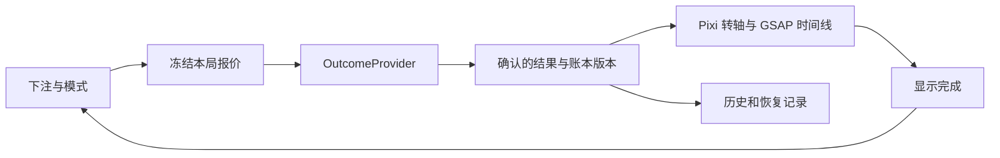

# 墨西哥街头食物老虎机交互与技术方案

日期：2026-10-12。状态：设计版 v1。工作名：**Mercado de Oro**，名称需在品牌定稿时确认。

输入方案：[街头食物内核稿](input-kernel-design.md)。

实现更新（2026-10-12）：核心 Pixi 可玩版本已进入 `codex/street-food-slot` 分支，详见 [实现状态](../README.md) 和 [精确配置证书](math-certificate.json)。下文保留设计版的目标与推导；原先“未联合求解”的状态和 2600 份示例倍率表已由当前独立配置替代。视频和实机验收仍待后续阶段完成。

首代采用 3×3 食物主盘、五条固定线和独立酱料倍率轴。玩家在旋转前选择基础投注与 Extra Salsa，点击一次完成开奖。交互强调主盘和倍率的先后揭示、清楚的实际支付及中奖明细。表现采用写实食物精灵、PixiJS 实时转轴、GSAP 动画和可选夜市环境视频。规则、随机抽取与结算独立于画面。

本方案补全所附内核稿的交互、技术、资源、验收与开发顺序。附稿中的市场份额、受众和代际留存是产品假设，不作为已验证的技术结论。96.5% 是新数学配置的目标；当前尚无完整主盘概率表和该配置的 RTP 证书。

## 1 参考范围和首代边界

[Fortune Gems 官方介绍](https://tadagaming.com/pr-PT/PlusIntro/FortuneGems?locale=pt-PT&showGame=true)公开了 3×3、五线、独立倍率轴、六个倍率档和加付 50% 的 Extra Bets。可复用这些交互结构；新产品使用独立的食物美术、文案、代码与概率配置。

| 内容 | 本游戏的定义 |
| --- | --- |
| 主盘 | 三列三行，三列均参与五条固定线 |
| 倍率轴 | 第四列，仅中间倍率生效，不参与任何中奖线 |
| 单局 | 一次完整主盘抽取和一次独立倍率抽取，没有局内决策 |
| Wild | 黄金塔可，替代普通符号；全 Wild 线采用专门赔率 |
| 两种模式 | 常规与 Extra Salsa；开局前确定，本局冻结 |
| 首代扩展 | 保留下注、音量、速度、语言、规则和历史记录这些功能 |
| 后续产品 | 更高倍率、Nudge、连锁倍率作为独立配置或独立产品开发 |

首代不引入免费旋转、Bonus 回合、收集进度、摊位选择或球员式构筑。默认单次手动旋转。自动旋转可在后续独立定义次数、预算和停止规则；极速属于表现速度设置。

原作的精确数学仍有公开信息缺口：介绍页对 Wild 同时出现 3x 和 25x 的描述，[官方 Game Sheet](https://wbgame.tadagaming.com/All-In-One/production/file/tadaPlusPlayer/pdf/ZfAi0cEpCKPOCzMHEkHtAzg1Lvimx2ENG3DURoDP.pdf)还提及整盘奖励和多个 RTP 配置。**375 = 25 × 15 无法单独证明原作的单线 Wild 赔率或多线算法。** 以下规则是本游戏的明确约定，不宣称还原原作的隐藏概率表。

## 2 五线结算和金额口径

### 基础投注与实际支付

设基础投注为 B。常规实际支付 C=B；Extra Salsa 实际支付 C=1.5B。五条线平分基础投注，每条线的计奖投注为 B/5。加付部分用于切换倍率分布，不重复加入计奖投注。

底部同时展示基础投注与本次实际支付。示例：基础投注 10 MXN，Extra 开启后明确显示 **Pago por giro 15.00 MXN**。价格变化在确认旋转前可见，旋转过程中不能改模式或金额。

### 符号与单线赔率

| 稳定 ID | 西班牙语显示名 | 三连赔率 p，按单线基础投注计 |
| --- | --- | ---: |
| tortilla | Tortilla | 0.4 |
| chile | Chile | 1 |
| lime | Limón | 1.6 |
| avocado | Aguacate | 2 |
| esquite | Esquite | 2.4 |
| tamal | Tamal | 3 |
| taco | Taco | 4 |
| wild | Taco de Oro | 25 |

主盘坐标使用 `grid[row][column]`，上／中／下行为 0／1／2。五条线依次为中横线 `[1,1,1]`、上横线 `[0,0,0]`、下横线 `[2,2,2]`、左上至右下 `[0,1,2]`、左下至右上 `[2,1,0]`。这些是本游戏的固定顺序。

每条线只支付一次。三个全 Wild 支付 25；其余情况，枚举能由 Wild 替代构成的普通三连，选择其中最高赔率；不匹配则为 0。不额外叠加整盘奖金。

设五条线的赔率为 p1…p5，倍率轴中间结果为 M：

```text
基础主盘系数 G = (p1+p2+p3+p4+p5)/5
基础中奖金额 A = B × G
最终返还 P = A × M
净结果 = P − C
```

多线先相加，再统一乘一次 M。倍率轴上的上下两格只是滚动上下文；即使 M=15，主盘未中奖时 P 仍为 0。

### 最大赔付

各线最高 25，因此 G≤25。全盘九个 Wild 会让五线全部支付 25，G=25；再出现 15x 时，P=375B。最终主盘配置必须让这幅盘面以正概率出现，才能宣称该最大值可达。

| 模式 | 实际支付 | 最大返还金额 | 按实际支付计算的最大返还倍数 |
| --- | ---: | ---: | ---: |
| 常规 | B | 375B | 375x |
| Extra Salsa | 1.5B | 375B | 250x |

这修正了附稿的一个关键口径：保留相同主盘、15x 上限及基于 B 的计奖公式时，Extra 的最高实际支付倍数为 250x。界面随模式显示对应值。若要求两种模式都达到实际支付的 375x，需要重新定义计奖基数与概率约束。

若直接让五线都按 B 支付，最大值会变成 1875B；再截断至 375B 将改变期望，需要重新求解。本方案采用五线平分，避免事后截断破坏分解。

### 金额精度

首版演示账本用整数微单位，1 MXN=1,000,000 单位；赔率存为整数十分位。按整局计算并结算一次，不对每条线逐条舍入。初始投注档拟为 0.2、0.4、1、2、5、10、20、50 MXN，均使 Extra 支付可用两位小数表示。

小额返还可显示至三位或四位小数，规则明细显示精确账本值。正式钱包如果只接受分，必须确定整局舍入规则，并对每个投注档重新计算舍入后的 RTP，不能直接复用未舍入证明。

## 3 RTP 和波动校准

两个模式共享主盘分布。主盘 G 与倍率 M 在各模式内独立；下注金额只缩放金额，不改变抽样。近期结果、余额、语言、速度、网络和设备均不参与概率配置选择。

未舍入且没有额外奖金时：

```text
常规 RTP = E[G] × E[M常规]
Extra RTP = E[G] × E[MExtra] / 1.5
同 RTP 的条件：E[MExtra] = 1.5 × E[M常规]
```

同 RTP 表示每单位实际支付的期望返还相同；Extra 每局花费更高，期望金额损失也按实际支付放大。增加投入不构成收益优势。

倍率均值的比例不保证波动更高。按实际支付归一化的方差还取决于二阶矩：

```text
Var(P/C) = E[G²] × E[M²]/f² − RTP²
f常规=1，fExtra=1.5
```

主盘同样产生方差。数学验收需要同时检查 G 和 M 的分布、命中率、净盈利率与赔付尾部；低最大赢本身不能证明中低波动或长会话。

### 可验证的倍率示例

下面是我们自定义的示例，不是原作概率表，也不是最终发行配置。整数权重均以 2600 为总量：

| M | 常规权重 | Extra 权重 |
| ---: | ---: | ---: |
| 1 | 1560 | 0 |
| 2 | 520 | 2329 |
| 3 | 312 | 52 |
| 5 | 130 | 39 |
| 10 | 52 | 13 |
| 15 | 26 | 167 |

此例 E[M常规]=1.96，E[MExtra]=2.94，恰好满足 1.5 比例，且 Extra 移除 1x、提高 2x 与 15x 概率。二阶矩为 7.98 与 19.09；Extra 按实际支付归一化后为 19.09/2.25≈8.48444，高于常规的 7.98。

要把这组示例轴与 96.5% 匹配，主盘需满足 E[G]=193/392≈0.49234694。该均值尚需通过完整主盘配置求解，不能把倍率示例本身当成完整 RTP 验证。

### 主盘配置方案

使用三条循环虚拟转轴，每列独立抽取一个中心 stop。第 r 行符号为 `strip[(stop+r-1+N)%N]`，r=0、1、2，N 为该轴长度。保留真实的行间相关性。初始候选为每轴 64 个 stop，完整主盘仅 64³=262,144 种结果；若离散精度不足，调整 strip 长度或使用可审计整数 stop 权重，再联合求解倍率权重。

配置文件包含 strip、stop 权重、线顺序、赔率、两组倍率权重、金额单位、舍入规则和版本哈希。用有理数计算两种模式的精确 RTP、二阶矩、命中率、净盈利率与最大可达赔付；蒙特卡洛补充连败、余额分布和会话长度。所有合法模式切换都只依赖下一局的冻结配置。

## 4 美术和视听方向

采用傍晚至夜间的真实街头市场：深色金属机框、暖色灯光、陶碗、木质台面、烤制与蒸汽细节。食物符号是有明确轮廓的写实渲染或摄影式切片，保留空间与高光；普通塔可和黄金 Wild 的材质、轮廓及图标明确区分。

黄金 Wild 是有产品识别度的原创金属食物符号。普通食物保持自然颜色，避免糖果塑料质感、卡通大眼角色或通屏彩虹特效。倍率必须有清晰数字，酱料颜色和椒种只是辅助识别；酱料等级不宣称真实辣度的科学排名，西语名称在本地化审核时冻结。

背景可用 6–8 秒固定机位、向前播放的夜市循环，表现蒸汽、灯光与远景人流；不嵌入任何主盘符号、倍率或中奖金额。为横竖屏分别准备构图和 poster。环境素材晚到或播放失败时保留 poster，主盘仍可准确运行。

声音分为远景市场环境、轻节奏、转轴摩擦、单轴停轮、倍率揭示和金额反馈。第一次主动进入后启用音频；静音状态可保存。主盘未中奖时，高倍率只使用短停轮音；返还低于实际支付时使用中性反馈；庆祝根据净结果与实际支付倍数分级。结果音跟随停轮事件，而不是固定墙钟定时器。

开场可选 2–3 秒短 CG，首次显示一次并支持跳过；直接进入旋转台也是完整路径。开场与主场共用同一美术参考，食物、光照、机框和背景在样片验收时一起确认。

## 5 主界面布局

### 竖屏优先

以 390×844 为主构图，并检查 320×740。四列整体保持在视口内；3×3 主盘占转轴区域约 76%，倍率列约 24%，中间有明确分隔。倍率轴比单个主轴稍窄，但 15x 和中心定位框必须清晰。

```text
┌────────────────────────────────────┐
│ Mercado de Oro             音量  菜单│
│                                    │
│         夜市环境与原创机框             │
│   [ 食物 ][ 食物 ][ 食物 ]   [倍率]    │
│   [ 食物 ][ 食物 ][ 食物 ]   [ ×3 ]   │
│   [ 食物 ][ 食物 ][ 食物 ]   [倍率]    │
│                                    │
│   Retorno $33.60         明细       │
│                                    │
│   Extra Salsa   关闭／开启           │
│   Apuesta base  −  $10.00  ＋       │
│   Pago por giro $15.00             │
│            [    GIRAR    ]         │
│   Saldo $...        Último retorno │
└────────────────────────────────────┘
```

金额和主按钮位于拇指可达区域。主按钮触摸高度至少 56 px，其他必要触摸目标至少 44 px。上下两格倍率弱化，中间框常驻“本局倍率”的位置。规则中的五条线可逐条预览；实际中奖只描出中奖线，线两端有编号，不能只靠颜色识别。

### 横屏和桌面

横屏把余额、下注和 Extra 放到右侧控制列，转轴仍保留完整九格与第四轴。桌面采用固定最大内容宽度，主按钮与下注构成同一操作区。两种布局共享同一逻辑和结果，不强制手机横屏，不把竖屏简单缩小成横屏。

## 6 单次旋转交互

以下时长是原型预算，不是已测体验数据。普通旋转约 2.2–2.6 秒，极速约 0.9–1.2 秒；大奖展示可延长但支持跳至结算。

| 阶段 | 普通模式预算 | 屏幕行为 | 可操作内容 |
| --- | --- | --- | --- |
| 待机 | 无计时 | 下注、Extra、实际支付常驻 | 调整下注／模式、规则、旋转 |
| 接受请求 | 通常 0–300 ms，随网络变化 | 锁定本次报价，转轴开始准备运动 | 音量、帮助；价格编辑锁定 |
| 三个主轴停轮 | 接受结果后约 0.7–1.6 s | 左至右停轮，准确落到结果符号 | 可加速当前展示 |
| 倍率揭示 | 约 1.6–2.0 s | 中间倍率落位，受益中奖线被强调 | 可快速揭示同一结果 |
| 金额反馈 | 约 2.0–2.4 s | 展示返还和净结果，按需描线 | 大奖计数可跳过 |
| 完成 | 反馈结束 | 更新余额、记录与下一局操作 | 恢复下一次旋转 |

等待权威结果时，主按钮显示 **Confirmando／Confirming** 并禁止重复提交。收到结果后，旋转中的主按钮改为 **Revelar／Reveal**。点击只完成本次动画，不改变结果、不新增支付、不重新抽样。双击第一下之后不会提交第二局。

倍率轴每局都转，主盘没中奖也展示其真实结果；不根据连败、余额或玩家动作插入假近失、额外高倍率停顿或临时换赔率。

结算明细示例：基础投注 10，两条中奖线分别为 Taco 4 和 Limón 1.6；单线基础投注为 2，基础奖为 8+3.2=11.2。倍率 3x 得到返还 33.6。常规净结果 23.6；Extra 支付 15 时净结果 18.6。

## 7 弹窗和边界流程

| 场景 | 交互约定 |
| --- | --- |
| 首次玩法说明 | 核心资源就绪后，三个步骤说明五线、中心倍率与实际支付；确认后进入待机，菜单可重开 |
| Extra 开启 | 当场更新实际支付、倍率范围和最高实际支付倍数；简短说明写明加付 50%，详细规则可展开 |
| 余额不足 | 在提交前提示实际需要金额，提供调整投注；已有未决请求先恢复再判断余额 |
| 网络超时 | 使用同一 requestId 查询结果／重试，待确认时不接受下一局 |
| 请求明确未接受 | 解除锁定，保持余额与上一局结果，允许重新旋转 |
| 动画中断 | 保留已接受结果与权威余额，展示本局结果明细并支持重播 |
| 页面后台 | 暂停声音与画面调度，停止自动操作；返回时查询未决结果，不重抽 |
| 刷新 | 恢复未决 requestId 或最近已确认结果，再恢复可旋转状态 |
| 改语言 | 不关闭展开的规则，不改变报价或动画，不丢弃未确认的下注编辑 |
| 改速度 | 下一局应用新速度；当前动画只通过 Reveal 一次性结束 |
| 历史记录 | 展示支付、模式、九格、中奖线、中间倍率、返还与净结果；历史重播只展示已有结果 |

规则和历史使用可滚动 DOM 弹窗，有正确焦点、Escape 和触摸关闭方式。界面默认为 es-MX，可切换 en-US。图像不烧录语言或金额，所有可见文字、错误和无障碍名称来自同一目录。

## 8 技术选型和模块

| 层 | 选型 | 职责 |
| --- | --- | --- |
| 主盘和倍率轴 | PixiJS 8 | Sprite、转轴 mask、文字、中奖线、少量粒子与交互 |
| 动作编排 | GSAP 3 | 停轮、轻微回弹、描线、计数与跳过，明确生命周期 |
| 开发与构建 | TypeScript 严格模式、Vite 8／Rolldown | 类型契约、模块化、资源路径、生产构建与分包 |
| 外层界面 | HTML／CSS | 加载、规则、投注编辑弹窗、语言及无障碍输入 |
| 音频 | Web Audio | 分层混音、暂停、静音、生命周期回收 |
| 环境媒体 | 可选 MP4／WebM 与 poster | 开场和市场环境，不承载开奖结果 |
| 内核 | 纯 TypeScript 包 | 抽样、五线求值、倍率、精度、结算与验证工具 |
| 结果提供者 | LocalProvider／RemoteProvider | 演示与服务端模式共用同一结果契约 |

[PixiJS Assets](https://pixijs.com/8.x/guides/components/assets)提供缓存和按包加载；[性能指南](https://pixijs.com/8.x/guides/concepts/performance-tips)支持图集批处理与按设备降低纹理尺寸。GSAP [timeline](https://gsap.com/docs/v3/GSAP/gsap.timeline%28%29/)适合集中编排与取消。Vite 的[官方构建说明](https://vite.dev/guide/)明确生产构建采用 Rolldown。启动时以实际锁文件冻结补丁版本，不额外维护一套平行 Rolldown 配置。

主转轴需要组合数大量的真实符号排列，因此用实时精灵绘制。点球项目的“一种结果一条视频”适合有限动作；此项目复用它的媒体加载与生命周期经验，把视频职责限定在环境和开场。环境默认用 Canvas 下方的 HTMLVideoElement 播放，避免环境每帧都触发 Pixi HUD 重绘。

建议目录：

```text
mercado-slot/
  packages/kernel/        纯数学和 SpinResult 类型
  src/providers/          local、remote、结果查询
  src/controller/         旋转请求、恢复与显示状态
  src/presentation/       reels、multiplier、lines、effects
  src/audio/              mixer、事件音与后台暂停
  src/ui/                 shell、rules、history、bet editor
  src/i18n/               es-MX、en-US
  assets/manifests/        common、full、lite
  tools/math/             精确枚举、模拟与证书生成
  tools/assets/           图集、尺寸、格式与清单检查
  docs/                   设计、配置版本与验收记录
```

## 9 权威结果和显示状态

每局两个事实分别管理：结果请求是否接受，以及结果是否展示完。动画完成回调不负责扣款或派奖。



一个 `requestId` 对应一次结果。LocalProvider 在同一同步事务中完成接受、扣费、生成和派奖；演示日志可重演。RemoteProvider 通过服务端事务原子地生成结果、扣费和记账，超时后先查询同一 ID。正式模式的随机与钱包由服务端负责，客户端保留核对与展示功能。

典型契约：

```ts
type SpinQuote = {
  quoteId: string;
  configHash: string;
  baseStakeUnits: bigint;
  totalCostUnits: bigint;
  mode: 'standard' | 'extra';
  expiresAt?: number;
};
type SpinRequest = { requestId: string; quoteId: string };
type SpinResult = {
  spinId: string;
  requestId: string;
  configHash: string;
  mode: 'standard' | 'extra';
  baseStakeUnits: bigint;
  totalCostUnits: bigint;
  grid: SymbolId[][];
  reelStops: [number, number, number];
  lineWins: LineWin[];
  multiplier: 1 | 2 | 3 | 5 | 10 | 15;
  payoutUnits: bigint;
  balanceAfterUnits: bigint;
  ledgerVersion: string;
};
```

传输中的大整数使用十进制字符串，避免 JSON 与浮点转换。客户端重新求值可发现 grid、线明细或 payout 不一致，发生不一致先查询权威状态，不自行构造新结果。种子揭示若加入，绑定配置和请求；重演一致性与随机源无偏性分别验证。

演示模式使用显式种子以复现问题；正式模式使用经过评估的服务端随机源。整数权重抽样采用拒绝采样，避免直接取模的偏差。主轴0／1／2和倍率轴使用明确的独立抽样或分离随机流，禁止依据主盘是否中奖重新选择倍率分布。

后台恢复、换语言、改变窗口和重播都只作用于显示状态。只有权威响应更新余额和当前结果。进入 READY 前，要确认没有未决请求且上一局已有明确账本状态。

## 10 资源管线和性能预算

### 分包

| 包 | 内容 | 加载时点 |
| --- | --- | --- |
| common | 内核、模式、文字、必要 UI | 首屏 |
| lite-critical | 低分辨率完整符号图集、机框、poster | 默认先保证可旋转 |
| full-upgrade | 高分辨率同构图集与装饰 | 首屏后按设备与网络升级 |
| audio | 基础音效和环境声 | 首次交互前后，不无限堵塞首屏 |
| atmosphere | 横竖环境视频、可选开场 | 按需加载，可独立失败 |
| celebration | 分级粒子和额外声音 | 主玩法就绪后 |

Full 与 Lite 共用 symbolId、裁切框、中心点和透明边距；资源质量不改变概率与结算。在转轴完整的关键符号资源就绪前不能接受新旋转，环境视频就绪不作为扣款前提。

### 目标预算

这些为开发验收目标，需用生产构建和实机测量确认：

| 指标 | 首版目标 |
| --- | --- |
| 必需 JS／CSS gzip | ≤250 KB，超过时拆分非首屏能力 |
| Lite 可旋转首屏资源 | ≤1.2 MB 压缩传输量 |
| Full 非视频整包 | ≤8 MB 压缩资源 |
| 可选背景视频 | 每种方向 ≤2 MB，最多一个活动解码器 |
| 纹理尺寸 | Lite 图集以 1024 以内为起点，按实际小屏可读性确定 |
| 显示密度 | Lite DPR≤1.5，Full DPR≤2 |
| 帧率 | 目标设备转轴期间持续≥30 FPS；常规设备目标60 FPS |
| 待机 | 无持续转轴或粒子重绘；仅环境活动时调度需要的绘制 |

1024×1024 RGBA 图集解码约 4 MiB；2048×2048 约 16 MiB，不能只看 WebP 文件大小。图集、GPU 纹理、视频帧缓冲和屏幕缓冲分别测量。低端默认 Lite，无重滤镜和大范围模糊；升级需要用户可见性能稳定，失败保持 Lite。

ReelView 使用循环复用的少量 Sprite，每列绘制三格及有限上下缓冲，不为所有 stop 创建节点。GSAP 编排期间开启统一帧循环，结算后收回；不让 Pixi 与 GSAP 各自重复触发渲染。WebGL context 丢失后重新加载显示资源，结果与账本留在控制层。

### 美术资产产线

先确认一张包含普通食物、黄金 Wild、机框和夜市背景的风格帧，再制作八个符号。每个符号验收轮廓、小屏对比、统一光源、透明边缘、Wild 辨识和状态帧。图集导出工具生成 Full／Lite 与 manifest，清单记录哈希、尺寸、锚点和版权来源。

OpenArt 可用于食物与环境素材制作；Seedance 可用于环境循环和短开场。批量任务在风格帧及小批样片验收、取得准确报价后提交。视频需核对向前循环、镜头不漂移、不出现烧录数字／文字、不含被前景覆盖后仍明显运动的游戏符号。

## 11 验收和开发顺序

| 阶段 | 必须形成的结果 | 出口条件 |
| --- | --- | --- |
| 规则定稿 | 五线、Wild、多线、Extra、最大值、精度配置 | 开发、产品和数学使用相同公式与示例 |
| 核心样片 | 一个真实 Pixi 可玩闭环：旋转、停轮、倍率、结算 | 手机看得清九格和中心倍率，普通与小奖反馈一致 |
| 数学配置 | strip／权重、两模式配置、精确证书 | 目标RTP、方差、命中率、最大可达值和精度全部核对 |
| 小批美术 | 代表普通符号、Wild、机框与环境 | 实际小屏和完整旋转一起验收后才批量制作 |
| 完整前端 | 八个符号、明细、语言、历史、恢复、Full／Lite | 正常、丢包、后台、刷新和重播均保留同一结果 |
| 用户试玩 | 不同熟练度约 8–12 人 | 能解释第4轴、Extra实际支付和中奖明细，记录误读与决策时长 |
| 设备验收 | 低端 Android、iOS、限速网络 | 首屏、转轴FPS、解码内存、温度和恢复达标 |
| 网络交付 | HTTPS 固定版本试玩与 CI | 资源 MIME、CORS、缓存、刷新、语言与移动布局通过 |

核心验收案例包括：无中奖＋15x、两线同时中奖、Wild 替代、全 Wild 最大值、Extra 关闭1x、金额低于支付、最低下注精度、双击、请求超时、播放跳过、刷新未决结果、历史重播、语言切换、WebGL context 丢失、Lite 升级失败。

数学工具对所有合法 stop 组合和倍率档精确枚举；使用配置版本生成报告。模拟只补充分布与路径，不替代可枚举部分。自动化视觉测试不承担美术风格认定，固定随机种子的样片由人工检查。

正式小游戏使用独立目录／仓库发布。复用点球的结果契约思想、幂等、资源清单、后台暂停、语言目录及 CI 模式；本游戏的数学内核、转轴资源和会话流程独立实现。每个阶段都有可玩的固定版本，验收与完成状态同步更新。

## 12 当前交付状态

| 项目 | 状态 |
| --- | --- |
| 首代规则、交互、布局、技术和资产管线 | 本方案已定义 |
| 结算演示 | 固定盘面示例，可比较普通／Extra、多线、无中奖高倍率与最大值 |
| 数学边界检查 | 配套脚本检查512种单线、示例盘面、金额与倍率矩条件 |
| 完整主盘概率与96.5%配置 | 待联合求解，不在本次设计稿中宣称已达标 |
| 正式Pixi实现和最终美术 | 下一阶段按核心样片出口条件执行 |
| 原作隐藏内核的逐项等价 | 概率和部分奖励规则未公开，未作此承诺 |

方案附件：[数学边界检查脚本](street-food-slot-math-check.py)、[检查结果](street-food-slot-math-check.json)、[结算验证画面](street-food-slot-interaction-preview.png)。交互演示使用固定示例，不从示例频次推导概率。

交互示例已检查普通／Extra、全 Wild、未中奖高倍率、快速揭示、最低投注精度及 320 px 窄屏；窄屏内容宽与滚动宽均为 273 px，黄金 Wild 标签未溢出。示例的 JavaScript 语法及浏览器运行日志检查通过。这些结果验证口径与演示布局，不代表正式 Pixi 美术或完整概率配置的验收。
